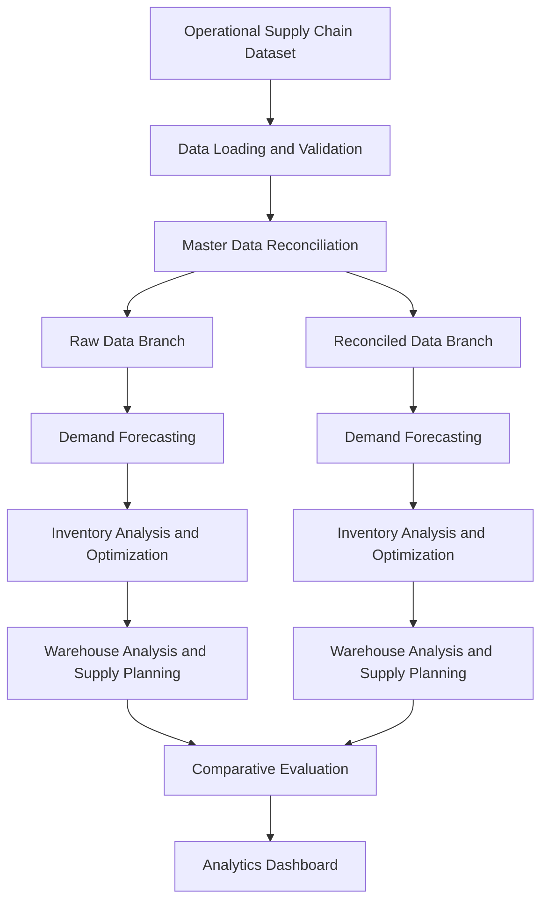

# 📦 Smart Supply Chain Analytics System

<p align="center">
  <strong>An Integrated Data-Driven Approach to Supply Chain Analytics, Demand Forecasting, Inventory Optimization, and Warehouse Planning</strong>
</p>

<p align="center">
  
  
  
  
  
</p>

---

## 📑 Table of Contents

- [Overview](#-overview)
- [Problem Statement](#-problem-statement)
- [Project Objectives](#-project-objectives)
- [Proposed System](#-proposed-system)
- [System Architecture](#-system-architecture)
- [Core Modules](#-core-modules)
- [Dataset Description](#-dataset-description)
- [Technology Stack](#-technology-stack)
- [Methodology](#-methodology)
- [Preliminary Results](#-preliminary-results)
- [Project Structure](#-project-structure)
- [Installation and Setup](#-installation-and-setup)
- [Running the Project](#-running-the-project)
- [Implementation Roadmap](#-implementation-roadmap)
- [Current Project Status](#-current-project-status)
- [Challenges and Limitations](#-challenges-and-limitations)
- [Future Scope](#-future-scope)
- [Contributing](#-contributing)
- [Author](#-author)

---

## 🔍 Overview

The **Smart Supply Chain Analytics System** is a data science project that aims to integrate multiple supply chain analytical processes into a unified platform.

Traditional supply chain operations involve multiple interconnected activities, including product and supplier data management, demand forecasting, inventory monitoring, and warehouse-level planning. When these activities operate independently or use inconsistent data, the resulting decisions may become unreliable.

This project proposes an integrated analytical system that combines:

- Master Data Management and Reconciliation
- Demand Forecasting
- Inventory Optimization
- Warehouse Inventory Analysis
- Supply Planning
- Comparative Performance Analysis
- Interactive Analytics and Visualization

A key focus of this project is to investigate how improving master data quality can influence downstream forecasting accuracy and supply chain decisions.

### 🎯 Central Research Question

**Does improving master data quality improve the reliability of downstream supply chain analytics and decision-making?**

---

## ❗ Problem Statement

Supply chain management involves large volumes of operational data generated across products, suppliers, warehouses, and sales activities.

However, several challenges can affect the quality and reliability of this information:

1. **Inconsistent Master Data:** Product, supplier, and warehouse records may contain duplicate, differently formatted, or inconsistent identifiers.
2. **Demand Uncertainty:** Historical demand patterns may be difficult to capture using simple forecasting approaches.
3. **Inventory Imbalance:** Poor demand estimates can contribute to excess inventory or insufficient stock.
4. **Warehouse-Level Inefficiencies:** Inventory distribution across warehouses may not align with regional demand.
5. **Disconnected Analytical Processes:** Forecasting, inventory management, and warehouse planning are often treated as separate activities.
6. **Data Quality Impact:** The effect of master data quality on downstream analytical performance needs to be evaluated.

The proposed system addresses these challenges through a connected data processing and analytical workflow.

---

## 🎯 Project Objectives

- Develop a structured master data reconciliation approach for product, supplier, and warehouse records.
- Improve the consistency and reliability of operational supply chain data.
- Build demand forecasting models using historical demand information.
- Evaluate different machine learning and deep learning forecasting approaches.
- Develop inventory analysis and optimization mechanisms using demand forecasts and inventory parameters.
- Analyze warehouse-level inventory distribution and supply planning requirements.
- Compare analytical outcomes using raw and reconciled datasets.
- Present relevant analytical insights through a unified dashboard.

---

## 💡 Proposed System

The system is designed around a connected analytical workflow.

Instead of treating each supply chain activity as an independent process, the proposed approach connects data quality management with forecasting and downstream operational analysis.

### Key capabilities

| Component | Purpose |
|---|---|
| Master Data Reconciliation | Identify and resolve inconsistent entity records |
| Demand Forecasting | Estimate future product demand |
| Inventory Optimization | Analyze reorder requirements, safety stock, and inventory levels |
| Warehouse Analysis | Identify warehouse-level stock imbalances |
| Supply Planning | Support inventory allocation and replenishment decisions |
| Comparative Analysis | Evaluate raw versus reconciled data outcomes |
| Dashboard | Present analytical results and insights |

---

## 🏗️ System Architecture

The proposed architecture follows a sequential data preparation stage followed by parallel analytical branches.



**Important:** The raw and reconciled branches are intended to undergo equivalent downstream processing so that their outcomes can be compared fairly.

---

## 🧩 Core Modules

<details>
<summary><strong>1. Master Data Management and Reconciliation</strong></summary>

The master data module focuses on identifying and resolving inconsistencies in product, supplier, and warehouse records.

**Main operations:**

- Identify duplicate and inconsistent records.
- Normalize text formats and identifiers.
- Detect variations in entity names.
- Match noisy records with canonical master entities.
- Generate reconciliation reports.
- Preserve mappings between original and reconciled records.

**Expected output:**

A standardized master dataset that can be linked with operational supply chain records.

</details>

<details>
<summary><strong>2. Demand Forecasting</strong></summary>

The forecasting module uses historical demand information to estimate future demand for products across warehouses.

**Models considered:**

- XGBoost
- LightGBM
- Long Short-Term Memory (LSTM)
- Gated Recurrent Unit (GRU)
- CNN-LSTM

**Evaluation metrics:**

- Mean Absolute Error (MAE)
- Root Mean Squared Error (RMSE)
- Mean Absolute Percentage Error (MAPE)

The forecasting models will be evaluated using a consistent data splitting and evaluation methodology.

</details>

<details>
<summary><strong>3. Inventory Optimization</strong></summary>

This module is intended to use demand forecasts and inventory-related attributes to support inventory decisions.

**Planned capabilities:**

- Inventory level monitoring.
- Reorder point analysis.
- Safety stock calculation.
- Replenishment requirement identification.
- Excess inventory identification.
- Potential stockout risk assessment.

</details>

<details>
<summary><strong>4. Warehouse Analysis and Supply Planning</strong></summary>

This module focuses on warehouse-level inventory distribution and supply planning.

**Planned capabilities:**

- Warehouse-wise inventory analysis.
- Identification of shortage and excess stock.
- Warehouse inventory comparison.
- Inventory balancing analysis.
- Supply and replenishment planning.

Genuine warehouse transfer optimization will require appropriate transfer cost, capacity, and lead-time information.

</details>

<details>
<summary><strong>5. Comparative Analysis</strong></summary>

A major research component of the project is comparing analytical performance using raw and reconciled data.

The comparison will investigate:

- Changes in forecasting error.
- Differences in inventory recommendations.
- Changes in warehouse-level analysis.
- The relationship between master data quality and downstream analytical reliability.

The same model configurations and evaluation conditions should be used across both branches wherever possible.

</details>

<details>
<summary><strong>6. Analytics Dashboard</strong></summary>

The dashboard is intended to provide a unified view of the system.

**Planned dashboard sections:**

- Data quality overview.
- Master data reconciliation summary.
- Demand forecasting results.
- Inventory analysis.
- Warehouse performance.
- Raw versus reconciled comparisons.

</details>

---

## 📊 Dataset Description

The primary operational dataset used during the preliminary implementation is a supply chain dataset containing daily product and warehouse-level information.

### Dataset overview

| Attribute | Value |
|---|---:|
| Total records | 91,250 |
| Total columns | 15 |
| Products / SKUs | 50 |
| Warehouses | 5 |
| Suppliers | 10 |
| Regions | 4 |
| Date range | January 1 – December 30, 2024 |

The dataset contains approximately one record per date, SKU, and warehouse combination.

### Dataset attributes

| Column | Description |
|---|---|
| Date | Operational record date |
| SKU_ID | Product identifier |
| Warehouse_ID | Warehouse identifier |
| Supplier_ID | Supplier identifier |
| Region | Associated region |
| Units_Sold | Units sold during the period |
| Inventory_Level | Recorded inventory level |
| Supplier_Lead_Time_Days | Supplier lead time |
| Reorder_Point | Inventory reorder threshold |
| Order_Quantity | Recorded order quantity |
| Unit_Cost | Product unit cost |
| Unit_Price | Product selling price |
| Promotion_Flag | Indicates promotional activity |
| Stockout_Flag | Indicates recorded stockout status |
| Demand_Forecast | Forecast-related dataset field |

### Data Quality Assessment

The initial data profiling process reported:

- No missing values.
- No exact duplicate rows.
- No negative values in the numerical fields checked.
- Valid binary values in promotion and stockout flags.

Some business relationships and field meanings still require further verification.

### Important Dataset Limitations

- The supplied `Stockout_Flag` contains only zero values.
- The meaning and generation logic of `Order_Quantity` require further investigation.
- The existing `Demand_Forecast` column must be examined for potential data leakage before being used in model training.
- Zero-demand observations require careful treatment when calculating MAPE.

The dataset should not be interpreted as a complete representation of real-world supply chain operations.

---

## 🛠️ Technology Stack

The following technologies form the intended project stack. The exact dependencies and deployment tools will be finalized as implementation progresses.

| Technology | Purpose |
|---|---|
| Python | Primary programming language |
| Pandas | Data manipulation and preprocessing |
| NumPy | Numerical operations |
| Scikit-learn | Machine learning utilities and evaluation |
| XGBoost | Gradient boosting forecasting |
| LightGBM | Gradient boosting forecasting |
| TensorFlow / Keras | Deep learning models, if required |
| Matplotlib / Seaborn | Data visualization |
| Streamlit | Planned interactive dashboard |
| PostgreSQL | Optional structured data storage |
| Git and GitHub | Version control and collaboration |

---

## 🔬 Methodology

The overall implementation methodology follows these stages:

1. **Data Acquisition:** Identify and load operational supply chain datasets.
2. **Data Profiling:** Understand dataset structure, distributions, and data types.
3. **Data Quality Assessment:** Identify missing values, duplicates, invalid values, and inconsistencies.
4. **Data Preparation:** Apply justified transformations and prepare validated datasets.
5. **Master Data Reconciliation:** Standardize entity records and create canonical mappings.
6. **Dataset Branching:** Establish raw and reconciled operational datasets.
7. **Demand Forecasting:** Train and evaluate forecasting models on both branches.
8. **Inventory Analysis:** Use forecasts and inventory attributes to evaluate replenishment requirements.
9. **Warehouse Analysis:** Evaluate warehouse-level inventory distribution.
10. **Comparative Evaluation:** Compare downstream results between the two branches.
11. **Dashboard Integration:** Present relevant results through a unified interface.

---

## 📈 Preliminary Results

The following forecasting metrics were reported in the preliminary project work.

They should be treated as preliminary results, not as independently verified results from the final integrated system.

### Forecasting Model Comparison

| Model | MAE | RMSE | MAPE |
|---|---:|---:|---:|
| XGBoost | 5.2066 | 6.5645 | 30.2089 |
| LightGBM | 5.3008 | 6.6691 | 30.4440 |
| LSTM | 4.6923 | 5.9694 | 29.4846 |
| GRU | 4.6806 | 5.9535 | 29.5150 |
| CNN-LSTM | **4.6194** | **5.8738** | 29.7555 |

### Preliminary Observations

- CNN-LSTM reported the lowest MAE.
- CNN-LSTM reported the lowest RMSE.
- GRU reported the lowest MAPE.
- Deep learning models showed competitive preliminary forecasting performance.

These values require reproducibility checks, including verification of data splitting, model inputs, forecast horizons, and zero-demand handling.

---

## 📁 Project Structure

The repository is organized into modular components to support independent development and easier maintenance.

```text
Smart_Supply_Chain_Analytics_System/
│
├── data/
│   ├── original/
│   ├── processed/
│   └── ...
│
├── src/
│   ├── reconciliation/
│   ├── forecasting/
│   ├── inventory/
│   ├── warehouse/
│   ├── planning/
│   ├── comparative/
│   └── utils/
│       ├── profiler.py
│       └── data_preparation.py
│
├── backend/
│   └── app/
│
├── dashboard/
│
├── tests/
│   ├── test_foundation.py
│   └── test_data_preparation.py
│
├── docs/
│
├── requirements.txt
├── README.md
├── PROJECT_STATUS.md
└── .gitignore
```

*Note: This is the intended modular organization. Some directories and modules may still be under development.*

---

## ⚙️ Installation and Setup

### Prerequisites

- Python 3.x
- Git
- GitHub account
- Antigravity or another Python-compatible development environment

### 1. Clone the repository

```bash
git clone https://github.com/AbhinavReddy118/Smart_Supply_Chain_Analytics_System.git
```

### 2. Navigate into the project

```bash
cd Smart_Supply_Chain_Analytics_System
```

### 3. Create a virtual environment

**macOS / Linux:**

```bash
python3 -m venv .venv
source .venv/bin/activate
```

**Windows:**

```powershell
python -m venv .venv
.venv\Scripts\activate
```

### 4. Install dependencies

```bash
python -m pip install --upgrade pip
pip install -r requirements.txt
```

### 5. Verify the environment

```bash
python --version
pip list
```

---

## ▶️ Running the Project

The data preparation utilities are among the implemented components.

The exact execution commands depend on the current entry points and repository configuration.

To run the existing automated tests:

```bash
python -m pytest tests/ -v
```

For individual modules, refer to their documentation and execution instructions as they are finalized.

---

## 🗺️ Implementation Roadmap

The project is being implemented incrementally.

- [x] Initial repository audit and environment setup
- [x] Project structure and dependency organization
- [x] Initial data profiling implementation
- [x] Initial data-quality assessment
- [x] Initial reusable data preparation pipeline
- [ ] Verify data preparation and business validation rules
- [ ] Complete master data reconciliation integration
- [ ] Build and validate demand forecasting pipeline
- [ ] Implement inventory optimization
- [ ] Implement warehouse analysis and supply planning
- [ ] Perform raw versus reconciled comparative evaluation
- [ ] Develop the interactive dashboard
- [ ] Integrate and test the complete prototype

**Progress labels reflect reported implementation milestones, not completion of the entire platform.**

---

## 📌 Current Project Status

**Project stage: Prototype development**

### Reported completed work

- Initial repository and environment setup.
- Modular project organization.
- Initial master data reconciliation and supporting dataset preparation.
- Initial data profiling and data-quality assessment.
- Reusable data preparation functionality.
- Preliminary demand forecasting model comparison.

### Work in progress

- Verification of data assumptions and business rules.
- Integration and validation of existing modules.
- Development of inventory and warehouse analytical components.
- End-to-end comparative evaluation.

The complete integrated Smart Supply Chain Analytics System is still under development.

---

## ⚠️ Challenges and Limitations

Some challenges that require attention during implementation:

1. Limited availability of real-world operational datasets.
2. Potential inconsistencies in generated or simulated supply chain data.
3. Lack of positive stockout observations in the primary dataset.
4. Need to verify the meaning of order quantity and existing forecast fields.
5. Need for appropriate data splitting and leakage prevention in forecasting.
6. Additional operational attributes required for genuine warehouse transfer optimization.
7. Need for consistent experimental conditions across raw and reconciled datasets.

---

## 🚀 Future Scope

Potential future improvements within the project's supply chain analytics scope include:

- More robust entity matching and reconciliation evaluation.
- Additional forecasting model experiments.
- Improved inventory replenishment strategies.
- Warehouse-level inventory balancing.
- More detailed supply planning analysis.
- Expanded analytical visualizations.
- Evaluation using larger and more diverse operational datasets.

---

## 🤝 Contributing

Contributions, suggestions, and constructive feedback are welcome.

If you would like to contribute:

1. Fork the repository.
2. Create a feature branch.
3. Implement your changes.
4. Add or update relevant tests.
5. Submit a pull request with a clear explanation.

Use meaningful commit messages and avoid committing credentials, private information, or unnecessary generated files.

---

## 👨‍💻 Author

**Abhinav Reddy**

Data Science Student | Project Developer

GitHub: [@AbhinavReddy118](https://github.com/AbhinavReddy118)

Project Repository: [Smart Supply Chain Analytics System](https://github.com/AbhinavReddy118/Smart_Supply_Chain_Analytics_System)

---

<p align="center">
  <strong>Smart Supply Chain Analytics System</strong><br>
  <em>Connecting data quality, forecasting, inventory analysis, and supply chain decisions.</em>
</p>
